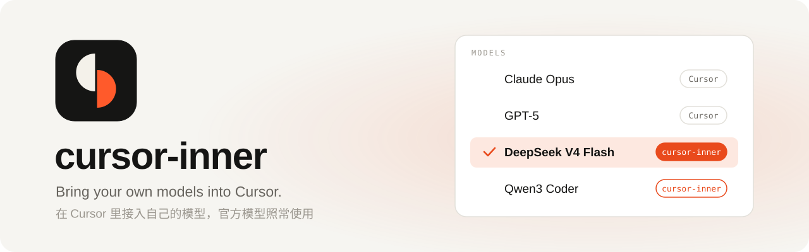
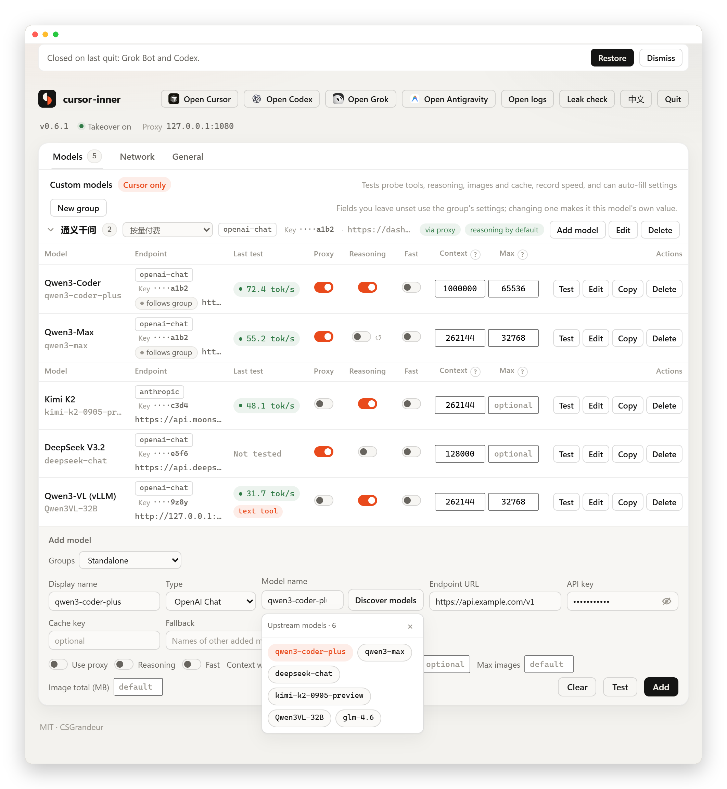
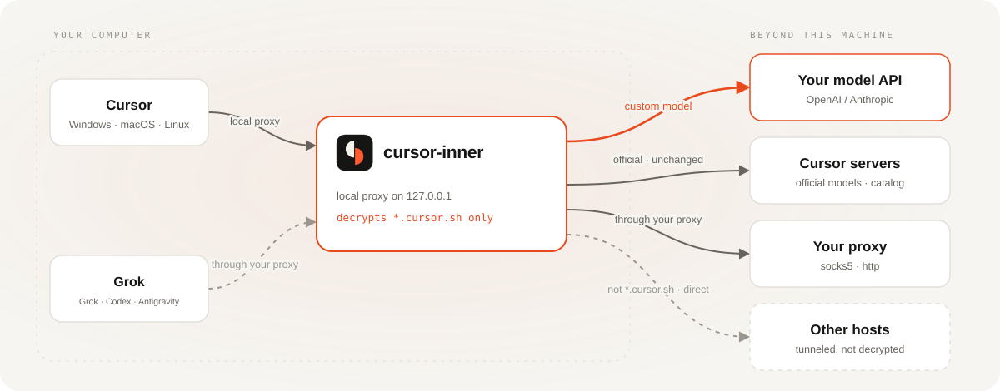

<p align="center">
  <picture>
    <source media="(prefers-color-scheme: dark)" srcset="docs/images/banner-dark.svg">
    
  </picture>
</p>

<p align="center"><sub>Your models in Cursor's Agent · Cursor, Grok and Codex through your proxy</sub></p>

<p align="center">
  <a href="https://github.com/CSGrandeur/cursor-inner/releases/latest"></a>
  <a href="https://github.com/CSGrandeur/cursor-inner/releases"></a>
  <a href="https://github.com/CSGrandeur/cursor-inner/stargazers"></a>
  <a href="#installation"></a>
  <a href="go.mod"></a>
  <a href="LICENSE"></a>
</p>

<p align="center">
  <a href="README.md">简体中文</a> · <b>English</b>
  <br>
  <a href="#installation">Installation</a> · <a href="#features">Features</a> · <a href="#usage">Usage</a> · <a href="#faq">FAQ</a>
</p>

<br>

cursor-inner runs on your computer. Custom models appear in Cursor's list and use Cursor's Agent to read and edit files, run commands, search, and call MCP tools and subagents from the current chat; official models are still sent to Cursor unchanged. Cursor, Grok, Codex and Antigravity use the one proxy address you enter, without changing the system proxy or enabling a system-wide TUN that carries other programs along. On quit, or on an unexpected exit, Cursor's previous proxy settings are written back. It runs on Windows, macOS and Linux, and the settings page switches between Chinese and English.

<p align="center">
  <picture>
    <source media="(prefers-color-scheme: dark)" srcset="docs/images/window-en-dark.png">
    
  </picture>
</p>

The model APIs you connect may charge for usage. cursor-inner is an independent project and is not affiliated with Cursor or its developers.

## Features

- **Your own models.** OpenAI Chat, OpenAI Responses and Anthropic endpoints. Add, test, edit and remove them on the settings page; once they pass, they are appended to the end of Cursor's model list.
- **Model groups.** Models from one provider share a group: enter the endpoint URL, type and API key once, and each model in the group only needs its model name, context window and the rest. A group collapses to a summary of its name, endpoint and key. A group can hold several Plans (Several URL + key sets for one platform; switch from the group header. For example pay-as-you-go and a token plan); maintain them with **Add plan**, and the models follow. Every model can still be configured on its own: whichever field you change in the form becomes that model's own value, and a switch you flipped in the table gets a reset that returns it to the group. Deleting a group turns its models into standalone models and keeps their settings.
- **Discover upstream models.** With the endpoint and key filled in, click **Discover models** next to the model name and pick from the provider's list.
- **Connectivity test.** A test probes tool calls, reasoning, images and cache, and records speed; the strip under the table shows the stages, a progress bar and the live output token count, with a Cancel button while it runs. Results are saved with the model.
- **Official models unchanged.** The list is only appended to, never replaced; official requests go to Cursor as they are. Switching back to an official model in the same chat is not affected by earlier custom-model turns.
- **Agent work.** Read and edit files, run commands, search, call MCP tools and subagents from the current chat; edits show a diff and are written after you accept them. The context usage bar is the same one built-in models get.
- **Long tasks keep going.** A model can leave a background command on this machine and is woken to continue when it ends, or when a matching line of output appears.
- **Stops that make sense.** Stop shows a stopped notice; an upstream rejection or error explains itself and keeps completed steps and the checkpoint. After a hot update or restart, finished chats resume normally.
- **Your proxy.** Take over Cursor, Grok, Codex and Antigravity with one address, or send only official hosts through the proxy (Antigravity included) and connect directly to everything else. Taking over Antigravity also covers its WSL mode, without changing system or WSL settings. Each custom model chooses whether to use the proxy. If a connection still bypasses takeover, TUN mode or Strict mode covers official hosts only (TUN can also cover Antigravity, including WSL) and leaves other programs alone.
- **Update and quit.** Update in one click; Cursor and Grok keep running, and only signed releases are installed. Quitting, or an unexpected exit, restores Cursor's proxy settings; on Windows the close button only hides cursor-inner to the notification area.

## Installation

**macOS / Linux**

```bash
curl -fsSL https://raw.githubusercontent.com/CSGrandeur/cursor-inner/main/install.sh | sh
```

**Windows** (PowerShell)

```powershell
irm https://raw.githubusercontent.com/CSGrandeur/cursor-inner/main/install.ps1 | iex
```

The installer detects your OS and CPU, checks the file against the release `SHA256SUMS.txt`, and installs it for the current user. No administrator rights. For a specific version, set `CURSOR_INNER_VERSION=v0.6.1`.

<details>
<summary><b>Where it is installed</b></summary>

| Platform | Installed to | How to start |
| --- | --- | --- |
| Windows | `%LOCALAPPDATA%\Programs\cursor-inner\` | cursor-inner in the Start menu |
| macOS | `~/.local/bin/cursor-inner` | Run `cursor-inner` in Terminal |
| Linux | `~/.local/bin/cursor-inner` | cursor-inner in the app menu, or run it in a terminal |

</details>

<details>
<summary><b>First run: trust the local certificate</b></summary>

On first takeover, cursor-inner creates a root certificate, "cursor-inner Local CA", that exists only on this machine, and asks the system to trust it. Without that trust, Cursor cannot connect through the local proxy.

| Platform | What you will see |
| --- | --- |
| Windows | A prompt to install the certificate; choose Yes |
| macOS | A request for your login password, to add the certificate to the login keychain as trusted |
| Linux | A polkit dialog; `certutil` is installed in the same step if it is missing |

Without a desktop session, the settings page and the console show a `sudo` command you can copy.

</details>

<details>
<summary><b>Manual download</b></summary>

Download from [Releases](https://github.com/CSGrandeur/cursor-inner/releases/latest):

| Platform | File |
| --- | --- |
| Windows 10 / 11 | `cursor-inner-<version>-windows-amd64.exe` |
| macOS (Apple silicon / Intel) | `cursor-inner-<version>-darwin-arm64.tar.gz` / `darwin-amd64.tar.gz` |
| Linux (x86_64 / ARM64) | `cursor-inner-<version>-linux-amd64.tar.gz` / `linux-arm64.tar.gz` |

The binaries are not code-signed. The install script is not blocked by SmartScreen or Gatekeeper. For a browser-downloaded Windows file, run `Unblock-File .\cursor-inner-<version>-windows-amd64.exe` in PowerShell first. On macOS, run `xattr -d com.apple.quarantine cursor-inner` first.

</details>

## Usage

1. Run cursor-inner. It closes any running Cursor and opens the settings page. Open Cursor, Open Grok, Open Codex and Open Antigravity in the top bar start those apps and do not quit cursor-inner.
2. On Models, fill in the display name, model name, endpoint URL and API key. For several models from one provider, click **New group**, give the Group name and the shared URL, type and key, then add models into it. If you are unsure of the model name, click **Discover models** to pick from the upstream list. Click Test to verify; the area under the table shows the stages, progress and live token count. When editing, leave the key blank to keep it.
3. Open Cursor again, start a new chat, and pick the model you added. If Cursor is already open, it only fetches its model list about every 5 minutes while focused; to see the model right away, click Refresh model list in Cursor Settings → Models, or run Reload Window.
4. Click Quit when you are done. On Windows, the window close button only hides cursor-inner to the notification area; quit from the icon menu. Cursor's settings are restored.

   Before quitting it asks once and lists the apps that will be closed with it; tick "Don't ask again" to skip the question later. Only processes cursor-inner took over are closed, never ones you started yourself. Next time you open it, a bar at the top of the settings page can Restore the apps closed last time, through the proxy as before; Dismiss hides the bar.

> [!IMPORTANT]
> With **Auto** selected, Cursor only uses official models. Select a custom model in the list to use it.

The settings page has four tabs: **Models**, **Network**, **General** and **Update**. A URL ending in `#models`, `#network`, `#general` or `#update` opens that tab.

- **Models**: Cursor only. Add, discover and test; the key in the list carries a Key label and copies on click; Copy fills the add form including the key, masked until you reveal it. Groups appear as sections; click a group header to collapse or expand it, leaving only the summary, and add models to the group, edit it or delete it right from the header. A member's endpoint column reads "follows group", and fields that differ from the group are marked custom, with a hover listing which ones. When a group holds several plans, the group header shows a plan selector; switching it makes the members use the new plan's URL, type and key at once. In the group editor, the plans section adds a set with **Add plan**, each with a plan name, type, URL and key; leaving the key blank while editing keeps the stored one. The group selector at the top of the form picks an existing group, standalone, or a new group; with a group selected, leaving the URL, type or key blank follows the group. Fields you leave unset use the group's settings; changing one makes it this model's own value. Context window, max output, max images, image total (MB), reasoning, Fast, cache key and fallback can be left empty; images are shrunk when read, and a request over the limits drops the oldest tool images first, keeping the newest few. Fallback takes the names of other added models, comma-separated, used before any text has been shown when authentication fails or the endpoint is rate-limited. The ? next to Context window and Max output opens a small help card. With reasoning on, Cursor's effort list follows the model's documented levels.
- **Network**: the proxy address, proxy scope (Global or Official only), Take over Cursor, Take over Grok, Take over Codex, Take over Antigravity, TUN mode and Strict mode. An empty proxy means a direct connection; a bare `host:port` is detected as socks5 or http. Official only includes Antigravity addresses. Taking over Antigravity also covers its WSL mode, without changing system or WSL settings. TUN mode can likewise cover Antigravity official traffic, including WSL. If cursor-inner starts before your proxy software, the status bar shows "Waiting for proxy…" and connects automatically once it is up; official traffic never goes direct.
- **Update**: the buttons are Check for updates and Update. Only signed releases are installed; Cursor and Grok keep running, and a version that fails its check leaves the current one in place.
- **General**: image generation and start at login. On Windows there is also **Run in background** and **Notifications**. To let Agent generate images, fill in an OpenAI-compatible endpoint under Images.

<details>
<summary><b>Command line</b></summary>

| Flag | Effect |
| --- | --- |
| `--no-takeover` | Open only the settings page. Do not change Cursor settings or close Cursor |
| `--debug` | Another copy with a temporary data directory. The Cursor and Grok you are using are left alone |
| `--verbose` | Also show debug lines in the window |
| `--data-dir <dir>` | Use this data directory |

</details>

## Where traffic goes

<p align="center">
  <picture>
    <source media="(prefers-color-scheme: dark)" srcset="docs/images/flow-en-dark.svg">
    
  </picture>
</p>

Cursor traffic that honors the proxy setting reaches this machine first: custom models are called from here, official models are forwarded unchanged, and other hosts are tunneled without decryption. Grok, Codex and Antigravity use the proxy you configured. The settings page accepts only local connections.

## Known limitations

- Web search merges Bing, DuckDuckGo and Baidu. Baidu sometimes returns only a captcha page, and then only the other two sources remain.
- With a custom model, typing `@` does not open the file menu. Drag a file into the chat, or use Add to Chat.
- Some APIs do not return a cache-hit count, so the window cannot show one.

## FAQ

<details>
<summary><b>I selected Auto. Why isn't my model used?</b></summary>

Auto chooses only among official models. Select your custom model in the list.

</details>

<details>
<summary><b>Can a custom model edit files and run commands?</b></summary>

Yes, when the model supports tool calls. In Agent it can read, search, edit and delete files, edit notebooks, run commands, call MCP tools from the current chat, and start a subagent. Edits show a diff and are written after you accept them. Stop aborts a tool that has not finished. Commit messages, chat titles and tab completion still come from Cursor.

</details>

<details>
<summary><b>Where is my API key stored?</b></summary>

| Platform | Data directory |
| --- | --- |
| Windows | `%APPDATA%\cursor-inner\` |
| macOS | `~/Library/Application Support/cursor-inner/` |
| Linux | `~/.config/cursor-inner/` (or `$XDG_CONFIG_HOME/cursor-inner/`) |

`config.json` holds the switches, the proxy and your custom models. **API keys are stored in plain text.** The file is readable only by the current user. Custom-model chats are in `conversations/`. The settings page and the local proxy listen on `127.0.0.1` only.

</details>

<details>
<summary><b>If cursor-inner exits unexpectedly, does Cursor lose its connection?</b></summary>

No. After a crash or a forced quit, your previous proxy settings are written back and Cursor is closed. Open Cursor again.

</details>

<details>
<summary><b>Will it keep working after Cursor updates?</b></summary>

Official models are not affected, and custom models are answered locally. If a custom-model turn hangs or fails to resume, update to this release and restart Cursor once.

</details>

<details>
<summary><b>How do I uninstall it?</b></summary>

1. If you turned on start at login, turn it off on the settings page, then click Quit.
2. Remove the root certificate:

   | Platform | Command |
   | --- | --- |
   | Windows | `certutil -user -delstore Root "cursor-inner Local CA"` |
   | macOS | `security delete-certificate -c "cursor-inner Local CA" ~/Library/Keychains/login.keychain-db` |
   | Linux (NSS) | `certutil -d sql:$HOME/.pki/nssdb -D -n "cursor-inner Local CA"` |
   | Debian / Ubuntu | `sudo rm /usr/local/share/ca-certificates/cursor-inner.crt && sudo update-ca-certificates --fresh` |
   | Fedora / RHEL | `sudo rm /etc/pki/ca-trust/source/anchors/cursor-inner.pem && sudo update-ca-trust` |
   | Arch and others | `sudo trust anchor --remove ~/.config/cursor-inner/ca/ca.crt` |

3. Delete the data directory and the program. If you used the installer, also delete `cursor-inner.lnk` from the Start menu on Windows, or `~/.local/share/applications/cursor-inner.desktop` on Linux.

</details>

## Development

Requires Go 1.26 or later.

```bash
go test ./...
./build.sh windows
./build.sh darwin arm64
VERSION=v0.6.1 ./build.sh linux
```

## Acknowledgements

Cursor protocol handling follows [cursor-byok](https://github.com/leookun/cursor-byok). License texts of dependencies are in [THIRD_PARTY_NOTICES.md](THIRD_PARTY_NOTICES.md).

---

<p align="center">
  <br>
  <sub><a href="LICENSE">MIT</a> © 2026 CSGrandeur · <a href="CHANGELOG.md">Changelog</a> · <a href="SECURITY.md">Security</a></sub>
</p>
