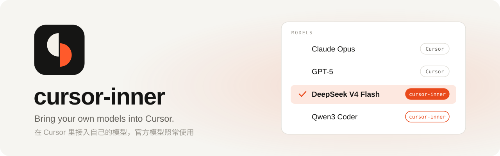
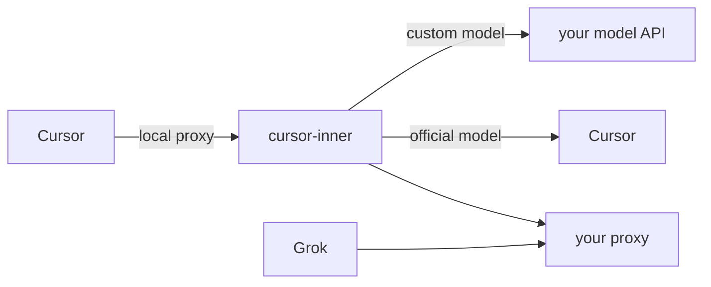

<p align="center">
  <picture>
    <source media="(prefers-color-scheme: dark)" srcset="docs/images/banner-dark.svg">
    
  </picture>
</p>

<p align="center"><sub>Your models in Cursor's Agent · Cursor, Grok and Codex through your proxy</sub></p>

<p align="center">
  <a href="https://github.com/CSGrandeur/cursor-inner/releases/latest"></a>
  <a href="https://github.com/CSGrandeur/cursor-inner/releases"></a>
  <a href="https://github.com/CSGrandeur/cursor-inner/stargazers"></a>
  <a href="#installation"></a>
  <a href="go.mod"></a>
  <a href="LICENSE"></a>
</p>

<p align="center">
  <a href="README.md">简体中文</a> · <b>English</b>
  <br>
  <a href="#installation">Installation</a> · <a href="#features">Features</a> · <a href="#usage">Usage</a> · <a href="#faq">FAQ</a>
</p>

<br>

cursor-inner runs on your computer. A custom model appears in Cursor's list and uses Cursor's Agent to read and edit files, run commands, search, and call MCP tools and subagents from the current chat. Official Cursor models are still sent to Cursor.

Cursor, Grok and Codex are taken over so they use the proxy you enter. A system proxy often fails to hold these three, and people then turn on a system-wide TUN, which carries other programs along. You do not have to change the system proxy or enable a system TUN, and other programs keep their own route. On quit, or if cursor-inner exits unexpectedly, Cursor's previous proxy settings are written back. It runs on Windows, macOS and Linux, and the settings page can be switched between Chinese and English.

<p align="center">
  
</p>

The model APIs you connect may charge for usage. cursor-inner is an independent project and is not affiliated with Cursor or its developers.

## Features

- **Your own models.** Add, test, edit and remove them on the settings page. They show up at the end of Cursor's model list.
- **Official models unchanged.** The list is only appended to. Requests for official models go to Cursor as they are.
- **Agent work.** A custom model can read and edit files, run commands, search, and call MCP tools and subagents from the current chat. Edits show a diff and are written after you accept them.
- **Your proxy.** Takes over only Cursor, Grok and Codex. One address, and they use it. You do not change the system proxy, or turn on a system-wide TUN that would carry other programs with it. You can also send only official hosts such as Grok, x.ai, Cursor and OpenAI through the proxy, and connect directly to everything else. Each custom model chooses whether to use the proxy. Codex is not started if it is not already running.
- **If a connection still bypasses.** After takeover, if one of the three still dials an official host directly, TUN mode or Strict mode inside cursor-inner covers those official hosts only. Other programs on the system are left alone. If either mode cannot start, takeover continues.
- **Update and quit.** Update in one click; Cursor and Grok keep running. Quitting, or an unexpected exit, writes Cursor's previous proxy settings back.

## Installation

**macOS / Linux**

```bash
curl -fsSL https://raw.githubusercontent.com/CSGrandeur/cursor-inner/main/install.sh | sh
```

**Windows** (PowerShell)

```powershell
irm https://raw.githubusercontent.com/CSGrandeur/cursor-inner/main/install.ps1 | iex
```

The installer detects your OS and CPU, checks the file against the release `SHA256SUMS.txt`, and installs it for the current user. No administrator rights. For a specific version, set `CURSOR_INNER_VERSION=v0.5.20`.

<details>
<summary><b>Where it is installed</b></summary>

| Platform | Installed to | How to start |
| --- | --- | --- |
| Windows | `%LOCALAPPDATA%\Programs\cursor-inner\` | cursor-inner in the Start menu |
| macOS | `~/.local/bin/cursor-inner` | Run `cursor-inner` in Terminal |
| Linux | `~/.local/bin/cursor-inner` | cursor-inner in the app menu, or run it in a terminal |

</details>

<details>
<summary><b>First run: trust the local certificate</b></summary>

On first takeover, cursor-inner creates a root certificate, "cursor-inner Local CA", that exists only on this machine, and asks the system to trust it. Without that trust, Cursor cannot connect through the local proxy.

| Platform | What you will see |
| --- | --- |
| Windows | A prompt to install the certificate; choose Yes |
| macOS | A request for your login password, to add the certificate to the login keychain as trusted |
| Linux | A polkit dialog; `certutil` is installed in the same step if it is missing |

Without a desktop session, the settings page and the console show a `sudo` command you can copy.

</details>

<details>
<summary><b>Manual download</b></summary>

Download from [Releases](https://github.com/CSGrandeur/cursor-inner/releases/latest):

| Platform | File |
| --- | --- |
| Windows 10 / 11 | `cursor-inner-<version>-windows-amd64.exe` |
| macOS (Apple silicon / Intel) | `cursor-inner-<version>-darwin-arm64.tar.gz` / `darwin-amd64.tar.gz` |
| Linux (x86_64 / ARM64) | `cursor-inner-<version>-linux-amd64.tar.gz` / `linux-arm64.tar.gz` |

The binaries are not code-signed. The install script is not blocked by SmartScreen or Gatekeeper. For a browser-downloaded Windows file, run `Unblock-File .\cursor-inner-<version>-windows-amd64.exe` in PowerShell first. On macOS, run `xattr -d com.apple.quarantine cursor-inner` first.

</details>

## Usage

1. Run cursor-inner. It closes any running Cursor and opens the settings page. Open Cursor, Open Grok and Open Codex in the top bar start those apps and do not quit cursor-inner.
2. On Models, fill in the display name, type, model name, endpoint URL and API key, then click Test. While it runs, the area under the list shows the probe stages, a progress bar and the live output token count. When editing, leave the key blank to keep it.
3. Open Cursor again, start a new chat, and pick the model you added. If Cursor is already open, it only fetches its model list about every 5 minutes while focused; to see the model right away, click Refresh model list in Cursor Settings → Models, or run Reload Window.
4. Click Quit when you are done. On Windows, the window close button only hides cursor-inner to the notification area; quit from the icon menu. Cursor's settings are restored.

   Before quitting it asks "Quit cursor-inner?" and lists "These apps connect through cursor-inner and will be closed too:" (Cursor, plus the Grok and Codex that cursor-inner took over), noting "Next time you can restore Grok and Codex in one click, with the proxy as before." Tick "Don't ask again" to quit without asking from then on, or click "Cancel" to stay. Ctrl+C, logging off and shutting down do not ask. Only processes cursor-inner took over are closed, never ones you started yourself; if cursor-inner is force-killed, its watchdog closes them. Next time you open cursor-inner, a bar at the top of the settings page lists what was closed: "Restore" reopens them through the proxy according to the current takeover settings (it reports an error rather than connecting directly if no proxy is available), and "Dismiss" hides the bar.

> [!IMPORTANT]
> With **Auto** selected, Cursor only uses official models. Select a custom model in the list to use it.

The settings page has four tabs: **Models**, **Network**, **General** and **Update**. A URL ending in `#models`, `#network`, `#general` or `#update` opens that tab.

- **Models**: Cursor only. Add and test. A test records speed and probes tools, reasoning, images and cache; the strip under the list shows the stages, progress and live token count. The key in the list has a Key label and copies on click; Copy fills the add form below including the key, which stays masked until you reveal it. Context window, max output, Max images, Image total (MB), reasoning, Fast, cache key and fallback can be left empty. Images are shrunk when read (long edge 1568 px, about 256 KB); when a request carries more images than the limits (default 20 images, 24 MB), the oldest tool images are left out in batches and the newest few are always kept. For Fallback, enter the names of other added models, comma-separated (Names of other added models, comma-separated); one is used before any text has been shown, when authentication fails or the endpoint is rate-limited. A name that is not in the list is reported and not saved. The ? next to Context window and Max output opens a small help card that explains the number and what an empty value means. When an update is available, the Update tab shows its notes as headings and lists.
- **Network**: the proxy address, proxy scope (Global or Official only), Take over Cursor, Take over Grok, Take over Codex, TUN mode and Strict mode. An empty proxy means a direct connection. A bare `host:port` is detected as socks5 or http. Adds proxy launch args to Codex; never starts it. That process sends its traffic through the proxy above.
- **Update**: the buttons are Check for updates and Update. Only signed releases are installed. Cursor and Grok keep running; a version that fails its check leaves the current one in place.
- **General**: image generation and start at login. On Windows there is also **Run in background** (No console window at startup; notification-area icon only.) and **Notifications** (System notifications for update results and leak warnings.). To let Agent generate images, fill in an OpenAI-compatible endpoint under Images.

<details>
<summary><b>Command line</b></summary>

| Flag | Effect |
| --- | --- |
| `--no-takeover` | Open only the settings page. Do not change Cursor settings or close Cursor |
| `--debug` | Another copy with a temporary data directory. The Cursor and Grok you are using are left alone |
| `--verbose` | Also show debug lines in the window |
| `--data-dir <dir>` | Use this data directory |

</details>

## Where traffic goes



Cursor traffic that honors the proxy setting reaches this machine first. Custom models are called from here. Official models are forwarded unchanged. Grok uses the proxy you configured. The settings page accepts only local connections.

## Known limitations

- Web search merges Bing, DuckDuckGo and Baidu. Baidu sometimes returns only a captcha page, and then only the other two sources remain.
- With a custom model, typing `@` does not open the file menu. Drag a file into the chat, or use Add to Chat.
- Some APIs do not return a cache-hit count, so the window cannot show one.

## FAQ

<details>
<summary><b>I selected Auto. Why isn't my model used?</b></summary>

Auto chooses only among official models. Select your custom model in the list.

</details>

<details>
<summary><b>Can a custom model edit files and run commands?</b></summary>

Yes, when the model supports tool calls. In Agent it can read, search, edit and delete files, edit notebooks, run commands, call MCP tools from the current chat, and start a subagent. Edits show a diff and are written after you accept them. Stop aborts a tool that has not finished. Commit messages, chat titles and tab completion still come from Cursor.

</details>

<details>
<summary><b>Where is my API key stored?</b></summary>

| Platform | Data directory |
| --- | --- |
| Windows | `%APPDATA%\cursor-inner\` |
| macOS | `~/Library/Application Support/cursor-inner/` |
| Linux | `~/.config/cursor-inner/` (or `$XDG_CONFIG_HOME/cursor-inner/`) |

`config.json` holds the switches, the proxy and your custom models. **API keys are stored in plain text.** The file is readable only by the current user. Custom-model chats are in `conversations/`. The settings page and the local proxy listen on `127.0.0.1` only.

</details>

<details>
<summary><b>If cursor-inner exits unexpectedly, does Cursor lose its connection?</b></summary>

No. After a crash or a forced quit, your previous proxy settings are written back and Cursor is closed. Open Cursor again.

</details>

<details>
<summary><b>Will it keep working after Cursor updates?</b></summary>

Official models are not affected. If Cursor changes its internal protocol, custom models may wait for a cursor-inner update.

</details>

<details>
<summary><b>How do I uninstall it?</b></summary>

1. If you turned on start at login, turn it off on the settings page, then click Quit.
2. Remove the root certificate:

   | Platform | Command |
   | --- | --- |
   | Windows | `certutil -user -delstore Root "cursor-inner Local CA"` |
   | macOS | `security delete-certificate -c "cursor-inner Local CA" ~/Library/Keychains/login.keychain-db` |
   | Linux (NSS) | `certutil -d sql:$HOME/.pki/nssdb -D -n "cursor-inner Local CA"` |
   | Debian / Ubuntu | `sudo rm /usr/local/share/ca-certificates/cursor-inner.crt && sudo update-ca-certificates --fresh` |
   | Fedora / RHEL | `sudo rm /etc/pki/ca-trust/source/anchors/cursor-inner.pem && sudo update-ca-trust` |
   | Arch and others | `sudo trust anchor --remove ~/.config/cursor-inner/ca/ca.crt` |

3. Delete the data directory and the program. If you used the installer, also delete `cursor-inner.lnk` from the Start menu on Windows, or `~/.local/share/applications/cursor-inner.desktop` on Linux.

</details>

## Development

Requires Go 1.26 or later.

```bash
go test ./...
./build.sh windows
./build.sh darwin arm64
VERSION=v0.5.20 ./build.sh linux
```

## Acknowledgements

Cursor protocol handling follows [cursor-byok](https://github.com/leookun/cursor-byok). License texts of dependencies are in [THIRD_PARTY_NOTICES.md](THIRD_PARTY_NOTICES.md).

---

<p align="center">
  <br>
  <sub><a href="LICENSE">MIT</a> © 2026 CSGrandeur · <a href="CHANGELOG.md">Changelog</a> · <a href="SECURITY.md">Security</a></sub>
</p>
