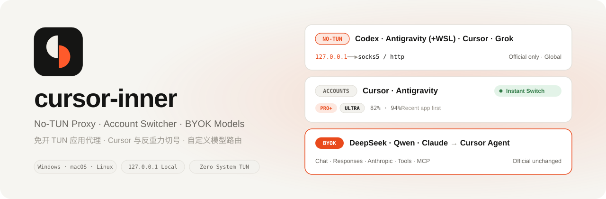
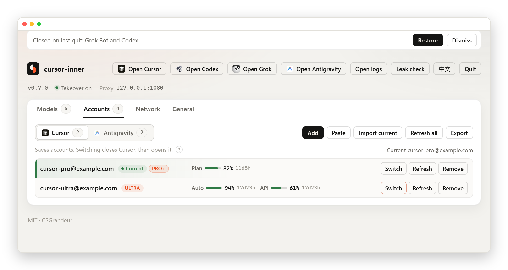
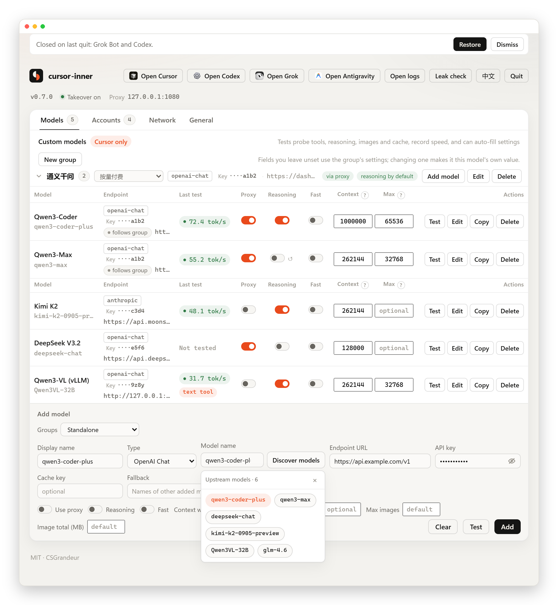
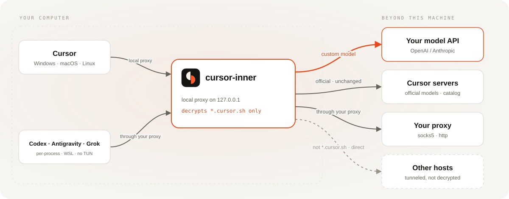

<p align="center">
  <picture>
    <source media="(prefers-color-scheme: dark)" srcset="docs/images/banner-dark.svg">
    
  </picture>
</p>

<p align="center"><sub>Route Codex, Antigravity, Cursor & Grok through your proxy without TUN · Switch Cursor & Antigravity accounts · Run your own models in Cursor</sub></p>

<p align="center">
  <a href="https://github.com/CSGrandeur/cursor-inner/releases/latest"></a>
  <a href="https://github.com/CSGrandeur/cursor-inner/releases"></a>
  <a href="https://github.com/CSGrandeur/cursor-inner/stargazers"></a>
  <a href="#installation"></a>
  <a href="go.mod"></a>
  <a href="LICENSE"></a>
</p>

<p align="center">
  <a href="README.md">简体中文</a> · <b>English</b>
  <br>
  <a href="#core-capabilities">Capabilities</a> · <a href="#previews">Previews</a> · <a href="#installation">Installation</a> · <a href="#usage">Usage</a> · <a href="#where-traffic-goes">Where traffic goes</a> · <a href="#faq">FAQ</a>
</p>

<br>

cursor-inner runs locally on your machine and brings three everyday workflows into one lightweight control panel: per-process proxy takeover without a system-wide TUN, unified account management and switching for both Cursor and Antigravity, and your own model endpoints inside Cursor's Agent. Available on Windows, macOS, and Linux, with instant Chinese/English switching and strictly `127.0.0.1`-only local listeners.

> The model APIs you connect may charge for usage. cursor-inner is an independent open-source project and is not affiliated with Cursor, Anthropic, Google, or OpenAI.

## Core capabilities

<table width="100%">
  <tr>
    <td width="33.3%" valign="top">
      <p><b>1. No-TUN app proxy</b></p>
      <p>Enter one outbound proxy (<code>socks5</code> / <code>http</code>) to route <b>Codex</b>, <b>Antigravity</b>, <b>Cursor</b>, and <b>Grok</b> without a system TUN, system proxy edits, or <code>hosts</code> changes.</p>
      <ul>
        <li><b>Covers WSL mode</b>: Antigravity's WSL language server and remote downloads go through your proxy automatically without touching system or WSL config files.</li>
        <li><b>Official-only by default</b>: sends only OpenAI, Antigravity, Google, Cursor, and x.ai hosts via proxy while keeping LAN and other apps direct, with Global and official-only TUN / Strict fallback.</li>
      </ul>
    </td>
    <td width="33.3%" valign="top">
      <p><b>2. Multi-IDE account switching</b></p>
      <p>A dedicated <b>Accounts</b> tab manages multiple <b>Cursor</b> and <b>Antigravity</b> sessions side by side, putting whichever IDE you used most recently first.</p>
      <ul>
        <li><b>Flexible onboarding</b>: browser sign-in, pasted tokens/cookies, batch JSON import, importing the active IDE session, and local backup export.</li>
        <li><b>Tiers &amp; clean switch</b>: inspect <code>ULTRA</code>, <code>PRO+</code>, <code>PRO</code>, and <code>FREE</code> quotas with reset timers; switching closes the app, writes credentials (incl. WSL and <code>state.vscdb</code>-less builds), and reopens cleanly.</li>
      </ul>
    </td>
    <td width="33.3%" valign="top">
      <p><b>3. Custom models in Cursor</b></p>
      <p>Connect OpenAI Chat, OpenAI Responses, and Anthropic endpoints appended only to Cursor's list, leaving official models untouched.</p>
      <ul>
        <li><b>Groups &amp; multi-plan sets</b>: share URL, type, and key per provider, swap Pay-as-you-go and Token Plans from the group header, or override and reset per model.</li>
        <li><b>Full Agent workflow</b>: upstream model discovery and a six-stage capability/speed probe; edit files with diffs, run background commands, invoke MCP and subagents, with safe recovery and fallback.</li>
      </ul>
    </td>
  </tr>
</table>

## Previews

<p align="center">
  <picture>
    <source media="(prefers-color-scheme: dark)" srcset="docs/images/window-accounts-en-dark.png">
    
  </picture>
  <br>
  <sub><b>Accounts:</b> Cursor and Antigravity subtabs automatically put the most recently used IDE first with tiers, quotas, and one-click switching</sub>
</p>

<p align="center">
  <picture>
    <source media="(prefers-color-scheme: dark)" srcset="docs/images/window-en-dark.png">
    
  </picture>
  <br>
  <sub><b>Custom models:</b> model groups, plan selector, six-stage probe metrics, and upstream model discovery</sub>
</p>

## Installation

**macOS / Linux**

```bash
curl -fsSL https://raw.githubusercontent.com/CSGrandeur/cursor-inner/main/install.sh | sh
```

**Windows** (PowerShell)

```powershell
irm https://raw.githubusercontent.com/CSGrandeur/cursor-inner/main/install.ps1 | iex
```

The installer detects your OS and CPU, verifies `SHA256SUMS.txt` from the release, and installs for the current user without administrator rights. Pin a version with `CURSOR_INNER_VERSION=v0.7.1`.

<details>
<summary><b>Where it is installed</b></summary>

| Platform | Installed to | How to start |
| --- | --- | --- |
| Windows | `%LOCALAPPDATA%\Programs\cursor-inner\` | cursor-inner in the Start menu |
| macOS | `~/.local/bin/cursor-inner` | Run `cursor-inner` in Terminal |
| Linux | `~/.local/bin/cursor-inner` | cursor-inner in the app menu, or run it in a terminal |

</details>

<details>
<summary><b>First run: trust the local certificate</b></summary>

On first takeover, cursor-inner creates a root certificate, "cursor-inner Local CA", that exists only on this machine, and asks the system to trust it. Without that trust, Cursor cannot connect through the local proxy.

| Platform | What you will see |
| --- | --- |
| Windows | A prompt to install the certificate; choose Yes |
| macOS | A request for your login password, to add the certificate to the login keychain as trusted |
| Linux | A polkit dialog; `certutil` is installed in the same step if it is missing |

Without a desktop session, the settings page and the console show a `sudo` command you can copy.

</details>

<details>
<summary><b>Manual download</b></summary>

Download from [Releases](https://github.com/CSGrandeur/cursor-inner/releases/latest):

| Platform | File |
| --- | --- |
| Windows 10 / 11 | `cursor-inner-<version>-windows-amd64.exe` |
| macOS (Apple silicon / Intel) | `cursor-inner-<version>-darwin-arm64.tar.gz` / `darwin-amd64.tar.gz` |
| Linux (x86_64 / ARM64) | `cursor-inner-<version>-linux-amd64.tar.gz` / `linux-arm64.tar.gz` |

The binaries are not code-signed. The install script is not blocked by SmartScreen or Gatekeeper. For a browser-downloaded Windows file, run `Unblock-File .\cursor-inner-<version>-windows-amd64.exe` in PowerShell first. On macOS, run `xattr -d com.apple.quarantine cursor-inner` first.

</details>

## Usage

1. Run cursor-inner to open the settings page. **Open Cursor**, **Open Codex**, **Open Grok**, and **Open Antigravity** in the top bar launch those apps directly under current takeover settings without quitting cursor-inner.
2. If you only want Codex, Antigravity, or Grok to route through your proxy without turning on system TUN, set your outbound proxy on **Network** and enable the corresponding takeover switches (Official only by default).
3. To manage multiple sessions, switch to **Accounts** and add, import, or switch **Cursor** and **Antigravity** accounts.
4. To bring custom models into Cursor, configure endpoints or **New group** on **Models**, use **Discover models** if needed, verify capabilities with **Test**, and pick the model inside Cursor. While Cursor is open, it refreshes its model list roughly every 5 minutes when focused; to see new entries immediately, click **Refresh model list** in Cursor Settings → Models, or run Reload Window.
5. Click **Quit** when done. On Windows, closing the window only hides cursor-inner to the notification area; quit from the tray menu. Cursor's original proxy settings are restored automatically. Quitting asks once before closing taken-over child apps ("Don't ask again" skips later prompts) while leaving independent windows alone, and the next launch offers **Restore** or **Dismiss** at the top.

> [!IMPORTANT]
> With **Auto** selected in Cursor, only official models are used. Pick your custom model explicitly from the list to use it.

The settings page has five tabs: **Models**, **Accounts**, **Network**, **General**, and **Update**. Append `#models`, `#accounts`, `#network`, `#general`, or `#update` to jump straight to a tab.

- **Models**: Cursor only. Add, discover, test, copy (filling the form with key masked), and organize models into collapsible groups. Group headers offer plan switching when multiple plans are maintained via **Add plan** (leaving key blank while editing keeps the stored value). Fields left unset follow the group; editing one marks it custom with a per-row reset. Context window, max output, max images, image total (MB), reasoning, Fast, cache key, and comma-separated fallback model names are optional; `?` beside Context window and Max output opens quick reference help cards.
- **Accounts**: switches cleanly between **Cursor** and **Antigravity** subtabs, ordered automatically so whichever app was active most recently stays first. An empty list reads "No saved accounts yet.". The toolbar provides Add, Paste, Import current, Refresh all, and Export, with Import and Import JSON inside the paste drawer (Cursor accepts JWT, session cookie, `user_xxx::eyJ...`, JSON, and multi-line tokens; Antigravity accepts `1//` refresh tokens, JSON, and multi-line lists). Clicking Add opens browser authorization showing "Finish signing in in the browser. You can also copy this link." alongside Copy and Cancel. Rows show subscription tiers and quota bars with Switch, Refresh, and Remove actions; switching closes a running instance, writes credentials (including Antigravity WSL fallback files and OS keyrings), and reopens it with active takeover settings. Export files stay local.
- **Network**: outbound proxy address, proxy scope (Global or Official only), Take over Cursor, Take over Grok, Take over Codex, Take over Antigravity, TUN mode, and Strict mode. An empty address connects directly; a bare `host:port` is auto-detected as socks5 or http. Official only includes Cursor, OpenAI, Grok, x.ai, Antigravity, and Google-related addresses (such as google.dev and withgoogle.com), and covers Antigravity's WSL mode without editing system or WSL settings. TUN mode can likewise cover official Antigravity traffic (including WSL) when needed. If cursor-inner starts before your proxy software, the status bar displays "Waiting for proxy…" and connects automatically once listening; official traffic never leaks direct while waiting.
- **General**: image generation endpoint (OpenAI-compatible `GenerateImage`) and start at login, plus **Run in background** and **Notifications** on Windows.
- **Update**: **Check for updates** and **Update**. Installs only signed releases; Cursor and Grok keep running across port handover and failed checks roll back automatically. Restarting Grok under takeover keeps your `SAND_LOCAL_EXEC_ROOT` and, when that directory exists, starts Grok with it as the working directory so local Read/Write tools are not refused as outside the allowed root.

<details>
<summary><b>Command line</b></summary>

| Flag | Effect |
| --- | --- |
| `--no-takeover` | Open only the settings page. Do not change Cursor settings or close Cursor |
| `--debug` | Another copy with a temporary data directory. The Cursor and Grok you are using are left alone |
| `--verbose` | Also show debug lines in the window |
| `--data-dir <dir>` | Use this data directory |

</details>

## Where traffic goes

<p align="center">
  <picture>
    <source media="(prefers-color-scheme: dark)" srcset="docs/images/flow-en-dark.svg">
    
  </picture>
</p>

Proxy-aware Cursor traffic lands on `127.0.0.1` first: custom models call your APIs directly from this machine, official requests go to Cursor unchanged, and unrelated hosts tunnel untouched. Codex, Antigravity (including WSL), and Grok receive per-process proxy settings and local bridges routed to your outbound proxy without a system-wide TUN; under **Official only**, non-official traffic connects directly. Both the web console and local proxy accept loopback connections only.

## Known limitations

- Web search merges Bing, DuckDuckGo, and Baidu. When Baidu serves only a captcha page, results from the other two sources remain.
- With custom models selected, typing `@` does not open Cursor's file picker. Drag files into the chat or use Add to Chat.
- Endpoints that omit cache-hit metrics cannot display a cache hit rate in the UI.
- Signing in to or refreshing Antigravity accounts requires Antigravity to be installed on this computer first.

## FAQ

<details>
<summary><b>I selected Auto. Why isn't my model used?</b></summary>

Auto chooses only among official models. Select your custom model in the list.

</details>

<details>
<summary><b>Can I switch between a custom model and an official model in the same chat?</b></summary>

Yes. After a custom model has used tools, you can switch to an official model in the same chat and it can continue from those results. Switching back to a custom model also continues the same conversation.

</details>

<details>
<summary><b>Can a custom model edit files and run commands?</b></summary>

Yes, when the model supports tool calls. In Agent it can read, search, edit and delete files, edit notebooks, run commands, call MCP tools from the current chat, and start subagents. Edits preview diffs before applying; Stop cancels pending work; commit messages, chat titles, and Tab completion stay on Cursor.

Execution heartbeats keep active tools alive. If contact is lost or a tool stream closes early, the turn pauses cleanly and retains dispatched executions for ordered recovery instead of silently repeating side-effecting calls.

</details>

<details>
<summary><b>Where are API keys and account tokens stored?</b></summary>

| Platform | Data directory |
| --- | --- |
| Windows | `%APPDATA%\cursor-inner\` |
| macOS | `~/Library/Application Support/cursor-inner/` |
| Linux | `~/.config/cursor-inner/` (or `$XDG_CONFIG_HOME/cursor-inner/`) |

`config.json` stores switches, proxy settings, and custom models (**API keys are stored in plain text**); `cursor-accounts.json` and `antigravity-accounts.json` store saved account sessions. All files are user-readable only, and the local proxy and settings UI listen on `127.0.0.1` only.

</details>

<details>
<summary><b>If cursor-inner exits unexpectedly, does Cursor lose its connection?</b></summary>

No. When the main process exits or stops, it restores your previous proxy settings and closes any taken-over Cursor instance. Reopen Cursor to resume normally.

</details>

<details>
<summary><b>Will it keep working after Cursor updates?</b></summary>

Official models are unaffected, and custom models are served locally. If an update changes client framing and breaks turns or recovery, update cursor-inner to the latest release and restart Cursor once.

</details>

<details>
<summary><b>How do I uninstall it?</b></summary>

1. If you turned on start at login, turn it off on the settings page, then click Quit.
2. Remove the root certificate:

   | Platform | Command |
   | --- | --- |
   | Windows | `certutil -user -delstore Root "cursor-inner Local CA"` |
   | macOS | `security delete-certificate -c "cursor-inner Local CA" ~/Library/Keychains/login.keychain-db` |
   | Linux (NSS) | `certutil -d sql:$HOME/.pki/nssdb -D -n "cursor-inner Local CA"` |
   | Debian / Ubuntu | `sudo rm /usr/local/share/ca-certificates/cursor-inner.crt && sudo update-ca-certificates --fresh` |
   | Fedora / RHEL | `sudo rm /etc/pki/ca-trust/source/anchors/cursor-inner.pem && sudo update-ca-trust` |
   | Arch and others | `sudo trust anchor --remove ~/.config/cursor-inner/ca/ca.crt` |

3. Delete the data directory and binary. If installed via the installer script, remove `cursor-inner.lnk` from the Start menu (Windows) or `~/.local/share/applications/cursor-inner.desktop` (Linux).

</details>

## Development

Requires Go 1.26 or later.

```bash
go test ./...
./build.sh windows
./build.sh darwin arm64
VERSION=v0.7.1 ./build.sh linux
```

## Acknowledgements

Cursor protocol handling follows [cursor-byok](https://github.com/leookun/cursor-byok). Dependency license texts are included in [THIRD_PARTY_NOTICES.md](THIRD_PARTY_NOTICES.md).

---

<p align="center">
  <br>
  <sub><a href="LICENSE">MIT</a> © 2026 CSGrandeur · <a href="CHANGELOG.md">Changelog</a> · <a href="SECURITY.md">Security</a></sub>
</p>
