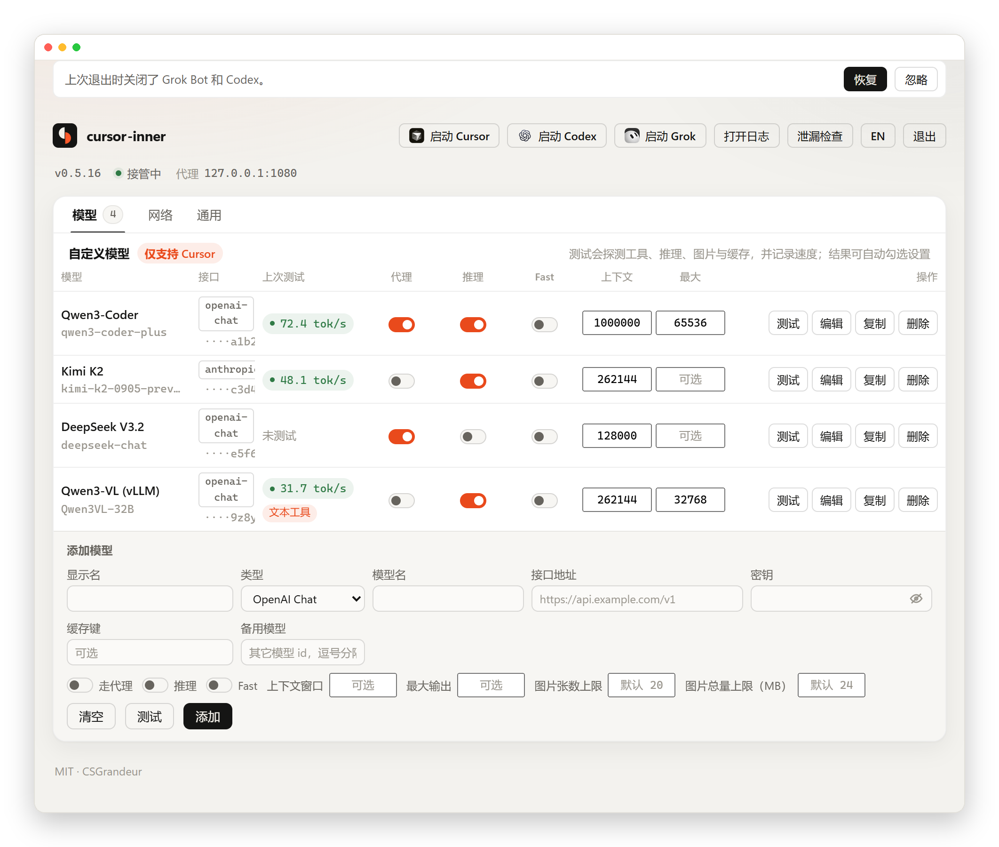
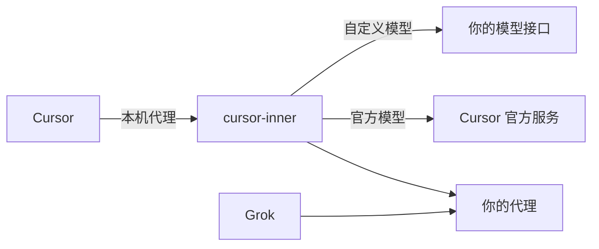

<p align="center">
  <picture>
    <source media="(prefers-color-scheme: dark)" srcset="docs/images/banner-dark.svg">
    
  </picture>
</p>

<p align="center"><sub>自己的模型用 Cursor 的 Agent · Cursor、Grok、Codex 走你的代理</sub></p>

<p align="center">
  <a href="https://github.com/CSGrandeur/cursor-inner/releases/latest"></a>
  <a href="https://github.com/CSGrandeur/cursor-inner/releases"></a>
  <a href="https://github.com/CSGrandeur/cursor-inner/stargazers"></a>
  <a href="#安装"></a>
  <a href="go.mod"></a>
  <a href="LICENSE"></a>
</p>

<p align="center">
  <b>简体中文</b> · <a href="README.en.md">English</a>
  <br>
  <a href="#安装">安装</a> · <a href="#功能">功能</a> · <a href="#使用">使用</a> · <a href="#常见问题">常见问题</a>
</p>

<br>

cursor-inner 在你的电脑上运行。自定义模型出现在 Cursor 的列表里，并用 Cursor 的 Agent 读改文件、运行命令、搜索，以及调用当前对话里的 MCP 和子代理。选 Cursor 自带的模型时，请求仍发给 Cursor。

接管 Cursor、Grok 和 Codex，让它们走你填的代理。系统代理往往兜不住这三个，有人便打开系统 TUN，其它程序也被带上。因此不必再改系统代理，也不必开系统 TUN，其它程序仍走原来的路。退出或意外结束时，Cursor 原来的代理设置会写回去。可用于 Windows、macOS 和 Linux，配置页可以切换中文和英文。

<p align="center">
  
</p>

模型接口可能另行计费。cursor-inner 是独立项目，与 Cursor 及其开发商没有关联。

## 功能

- **自己的模型。** 在配置页添加、测试、编辑和删除。通过后出现在 Cursor 模型列表末尾。
- **官方模型照常。** 列表只追加。选官方模型时，请求原样发往 Cursor。
- **Agent 能干活。** 自定义模型可以读改文件、运行命令、搜索，以及调用当前对话里的 MCP 和子代理。改动先在对话里看 diff，接受后才写入。
- **走你的代理。** 只接管 Cursor、Grok 和 Codex，填一个地址即可。不必为了这三个去改系统代理，也不必开系统 TUN 把其它程序一起带上。也可以只让 Grok、x.ai、Cursor、OpenAI 这些官方地址走代理，其余直连。每个自定义模型单独决定是否走代理。没在运行的 Codex 不会被拉起。
- **仍有直连时。** 接管之后，若这三个里还有个别官方连接不走代理，可在 cursor-inner 里打开 TUN 模式或严格模式，只覆盖官方地址，不动系统里其它程序。开不了就继续用接管。
- **更新和退出。** 有新版本时一键更新，Cursor 和 Grok 不用重启。退出或意外结束都会把 Cursor 原来的代理设置写回去。

## 安装

**macOS / Linux**

```bash
curl -fsSL https://raw.githubusercontent.com/CSGrandeur/cursor-inner/main/install.sh | sh
```

**Windows**（PowerShell）

```powershell
irm https://raw.githubusercontent.com/CSGrandeur/cursor-inner/main/install.ps1 | iex
```

安装脚本识别系统和 CPU，按 Release 里的 `SHA256SUMS.txt` 校验后装到当前用户目录，不需要管理员权限。指定版本：`CURSOR_INNER_VERSION=v0.5.8`。

<details>
<summary><b>装到了哪里</b></summary>

| 平台 | 安装位置 | 启动方式 |
| --- | --- | --- |
| Windows | `%LOCALAPPDATA%\Programs\cursor-inner\` | 开始菜单里的 cursor-inner |
| macOS | `~/.local/bin/cursor-inner` | 在终端运行 `cursor-inner` |
| Linux | `~/.local/bin/cursor-inner` | 应用菜单里的 cursor-inner，或在终端运行 |

</details>

<details>
<summary><b>首次运行要信任本机证书</b></summary>

第一次接管时，cursor-inner 会生成本机根证书「cursor-inner Local CA」，并请求系统信任它。不信任的话，Cursor 连不上本机代理。

| 平台 | 会看到什么 |
| --- | --- |
| Windows | 询问是否安装证书，选「是」 |
| macOS | 要求登录密码，把证书写入登录钥匙串并设为受信任 |
| Linux | polkit 授权框；缺少 `certutil` 时在同一次授权里安装 |

没有图形界面时，配置页和终端会给出可复制的 `sudo` 命令。

</details>

<details>
<summary><b>手动下载</b></summary>

从 [Releases](https://github.com/CSGrandeur/cursor-inner/releases/latest) 下载对应文件：

| 平台 | 文件 |
| --- | --- |
| Windows 10 / 11 | `cursor-inner-<版本>-windows-amd64.exe` |
| macOS（Apple 芯片 / Intel） | `cursor-inner-<版本>-darwin-arm64.tar.gz` / `darwin-amd64.tar.gz` |
| Linux（x86_64 / ARM64） | `cursor-inner-<版本>-linux-amd64.tar.gz` / `linux-arm64.tar.gz` |

程序没有代码签名。用安装脚本不会被 SmartScreen 或 Gatekeeper 拦住。浏览器下载的 Windows 文件，先在 PowerShell 里执行 `Unblock-File .\cursor-inner-<版本>-windows-amd64.exe`。macOS 上先执行 `xattr -d com.apple.quarantine cursor-inner`。

</details>

## 使用

1. 运行 cursor-inner。它会关掉正在运行的 Cursor，并打开配置页。顶栏的「启动 Cursor」「启动 Grok」「启动 Codex」再打开它们，不退出 cursor-inner。
2. 在「模型」里填写显示名、类型、模型名、接口地址和密钥，点「测试」。编辑时密钥留空表示不改。
3. 重新打开 Cursor，新开一个对话，在模型列表里选刚添加的模型。
4. 用完点「退出」。Windows 上点窗口关闭按钮只会收到通知区域，右键图标选「退出」才结束。Cursor 的设置会还原。

> [!IMPORTANT]
> 选 **Auto** 时 Cursor 只用官方模型。要用自定义模型，必须在列表里手动选。

配置页四个标签：**模型**、**网络**、**通用**、**更新**。网址末尾加上 `#models`、`#network`、`#general`、`#update` 可以直接打开。

- **模型**：仅支持 Cursor。添加和测试。测试会看速度，并探测工具、推理、图片和缓存。上下文窗口、最大输出、推理、Fast、缓存键和备用模型都可以留空。备用模型在还没输出文字时，用于鉴权失败或限流。
- **网络**：代理地址、代理范围（「全局」或「仅官方」）、接管 Cursor、接管 Grok、接管 Codex、TUN 模式、严格模式。代理留空则直连；只写 `主机:端口` 时自动识别 socks5 或 http。接管 Codex 给 Codex 加上代理启动参数；没在运行不会拉起。这个进程的联网都走上面的代理。
- **更新**：按钮是「检查更新」和「更新」。只安装签名有效的版本，更新时 Grok 和 Cursor 不用重启；新版本没通过检查会回到当前版本。
- **通用**：出图、开机启动。Windows 上还有**后台运行**（启动时不开控制台窗口，只留通知区域图标。）和**通知**（更新结果和泄漏告警弹系统通知。）。要让 Agent 生成图片，在「出图」里填 OpenAI 兼容接口。

<details>
<summary><b>命令行</b></summary>

| 参数 | 作用 |
| --- | --- |
| `--no-takeover` | 只打开配置页，不改 Cursor 设置，也不关闭 Cursor |
| `--debug` | 用临时数据目录再开一份：不改正在使用的 Cursor 和 Grok |
| `--verbose` | 窗口里也显示调试日志 |
| `--data-dir <目录>` | 使用指定的数据目录 |

</details>

## 流量怎么走



Cursor 里会读代理设置的流量先到本机：自定义模型由本机调用你的接口，官方模型原样转发。Grok 走你配置的代理。配置页只接受本机访问。

## 已知限制

- 网页搜索合并 Bing、DuckDuckGo 和百度。百度有时只返回验证页，这时只有另外两家的结果。
- 用自定义模型时，输入框里的 `@` 不会弹出文件菜单。把文件拖进对话，或用 Add to Chat。
- 有的接口不返回缓存命中数，窗口里就看不到缓存命中率。

## 常见问题

<details>
<summary><b>选了 Auto，为什么没用到我的模型？</b></summary>

Auto 只在官方模型里选。要使用自定义模型，在模型列表里手动选中它。

</details>

<details>
<summary><b>自定义模型能改文件、跑命令吗？</b></summary>

支持工具调用的模型可以。Agent 里能读文件、搜索、修改和删除、编辑笔记本、运行命令、调用本轮对话里的 MCP，以及启动子代理。修改先显示 diff，接受后才写入。点停止会中止还没结束的工具。提交说明、聊天标题和 Tab 补全仍由 Cursor 完成。

</details>

<details>
<summary><b>密钥存在哪里？</b></summary>

| 平台 | 数据目录 |
| --- | --- |
| Windows | `%APPDATA%\cursor-inner\` |
| macOS | `~/Library/Application Support/cursor-inner/` |
| Linux | `~/.config/cursor-inner/`（或 `$XDG_CONFIG_HOME/cursor-inner/`） |

`config.json` 里是开关、代理和自定义模型。**API 密钥以明文保存**，文件只有当前用户可读。自定义模型的对话在 `conversations/`。配置页和本机代理只监听 `127.0.0.1`。

</details>

<details>
<summary><b>cursor-inner 意外退出，Cursor 会连不上网吗？</b></summary>

不会。主进程崩溃或被强制结束后，会把你原来的代理设置写回，并关闭 Cursor。重新打开 Cursor 即可。

</details>

<details>
<summary><b>Cursor 升级后还能用吗？</b></summary>

官方模型不受影响。如果 Cursor 改了内部协议，自定义模型可能要等 cursor-inner 更新。

</details>

<details>
<summary><b>怎么卸载？</b></summary>

1. 开过开机启动的话，先在配置页关掉，再点「退出」。
2. 删除根证书：

   | 平台 | 命令 |
   | --- | --- |
   | Windows | `certutil -user -delstore Root "cursor-inner Local CA"` |
   | macOS | `security delete-certificate -c "cursor-inner Local CA" ~/Library/Keychains/login.keychain-db` |
   | Linux（NSS） | `certutil -d sql:$HOME/.pki/nssdb -D -n "cursor-inner Local CA"` |
   | Debian / Ubuntu | `sudo rm /usr/local/share/ca-certificates/cursor-inner.crt && sudo update-ca-certificates --fresh` |
   | Fedora / RHEL | `sudo rm /etc/pki/ca-trust/source/anchors/cursor-inner.pem && sudo update-ca-trust` |
   | Arch 等 | `sudo trust anchor --remove ~/.config/cursor-inner/ca/ca.crt` |

3. 删除数据目录和程序。用安装脚本装的，还要删除开始菜单里的 `cursor-inner.lnk`（Windows），或 `~/.local/share/applications/cursor-inner.desktop`（Linux）。

</details>

## 参与开发

需要 Go 1.26 或更新版本。

```bash
go test ./...
./build.sh windows
./build.sh darwin arm64
VERSION=v0.5.8 ./build.sh linux
```

## 致谢

Cursor 协议处理参考了 [cursor-byok](https://github.com/leookun/cursor-byok)。依赖的许可证原文见 [THIRD_PARTY_NOTICES.md](THIRD_PARTY_NOTICES.md)。

---

<p align="center">
  <br>
  <sub><a href="LICENSE">MIT</a> © 2026 CSGrandeur · <a href="CHANGELOG.md">更新日志</a> · <a href="SECURITY.md">安全策略</a></sub>
</p>
