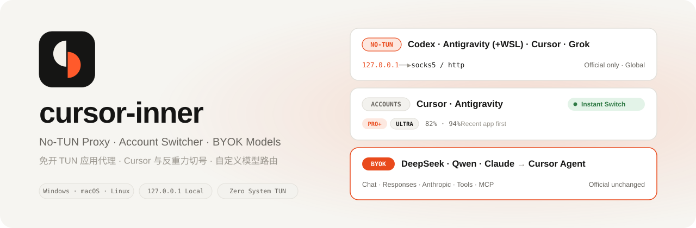
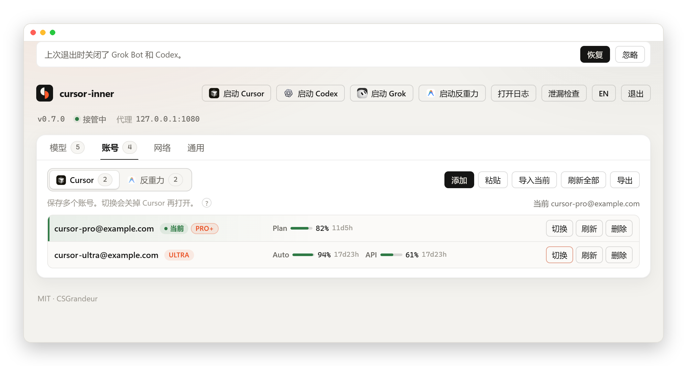
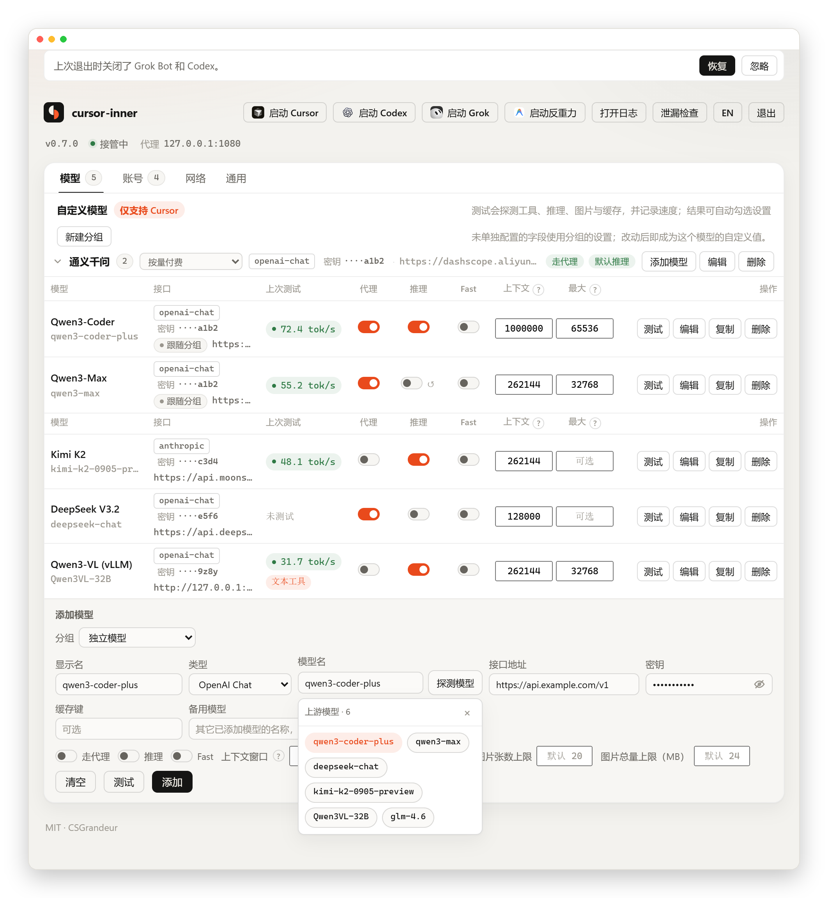
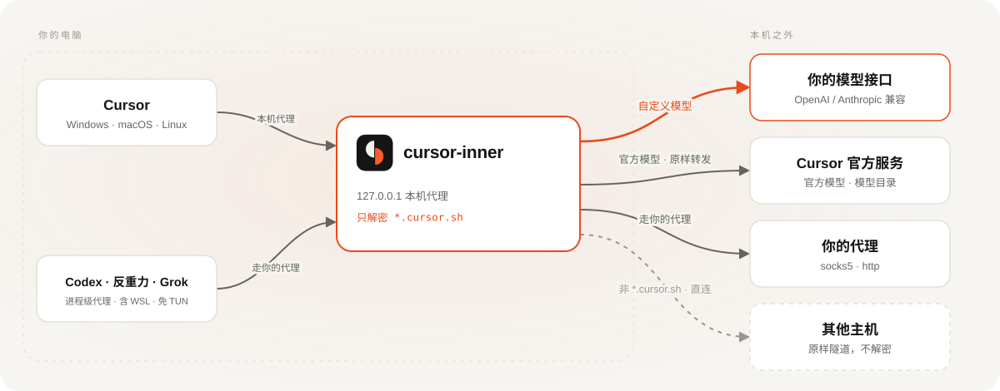

<p align="center">
  <picture>
    <source media="(prefers-color-scheme: dark)" srcset="docs/images/banner-dark.svg">
    
  </picture>
</p>

<p align="center"><sub>免开 TUN 让 Codex、反重力、Cursor、Grok 走你的代理 · Cursor 与反重力多账号切换 · 在 Cursor 接入自己的模型</sub></p>

<p align="center">
  <a href="https://github.com/CSGrandeur/cursor-inner/releases/latest"></a>
  <a href="https://github.com/CSGrandeur/cursor-inner/releases"></a>
  <a href="https://github.com/CSGrandeur/cursor-inner/stargazers"></a>
  <a href="#安装"></a>
  <a href="go.mod"></a>
  <a href="LICENSE"></a>
</p>

<p align="center">
  <b>简体中文</b> · <a href="README.en.md">English</a>
  <br>
  <a href="#核心能力">核心能力</a> · <a href="#界面预览">界面预览</a> · <a href="#安装">安装</a> · <a href="#使用">使用</a> · <a href="#流量怎么走">流量怎么走</a> · <a href="#常见问题">常见问题</a>
</p>

<br>

cursor-inner 运行在你自己的电脑上，把日常高频用到的三件事收到同一个轻量本地控制台里：免开系统 TUN 让指定 AI 客户端精准走代理、统一管理并切换 Cursor 与反重力多账号、以及把自己的模型接进 Cursor 原生 Agent。Windows、macOS、Linux 可用，配置页中英文即时切换，只监听本机 `127.0.0.1`。

> 模型接口可能另行计费。cursor-inner 是独立开源项目，与 Cursor、Anthropic、Google 或 OpenAI 没有关联。

## 核心能力

<table width="100%">
  <tr>
    <td width="33.3%" valign="top">
      <p><b>1. 免开 TUN 应用代理</b></p>
      <p>填一个出站代理（<code>socks5</code> / <code>http</code>），即可接管 <b>Codex</b>、<b>反重力</b>、<b>Cursor</b> 与 <b>Grok</b>，不改系统代理或 <code>hosts</code>，不开全局虚拟网卡。</p>
      <ul>
        <li><b>覆盖 WSL 模式</b>：接管反重力时，Linux 子系统里的语言服务与远程连接一并走代理，无需调整系统或 WSL 配置。</li>
        <li><b>默认仅官方分流</b>：仅 OpenAI、Antigravity、Google、Cursor、x.ai 地址走代理，局域网与常规网页直连；也可随时切全局或按需开启仅官方 TUN / 严格模式。</li>
      </ul>
    </td>
    <td width="33.3%" valign="top">
      <p><b>2. Cursor 与反重力切号</b></p>
      <p>独立的<b>账号</b>板块集中保存多组 <b>Cursor</b> 与<b>反重力</b>会话凭据，两个子标签按<b>最近使用的软件</b>自动排在最前。</p>
      <ul>
        <li><b>多种导入方式</b>：浏览器授权登录、粘贴令牌/Cookie、JSON 批量导入，或一键导入当前软件正在使用的账号，可随时导出本机备份。</li>
        <li><b>配额与无痛切号</b>：集中查看 <code>ULTRA</code>、<code>PRO+</code>、<code>PRO</code>、<code>FREE</code> 订阅档位、余量与重置时间；切号自动关闭软件、写入凭据后按接管设置重启。</li>
      </ul>
    </td>
    <td width="33.3%" valign="top">
      <p><b>3. Cursor 自定义模型</b></p>
      <p>接入 OpenAI Chat、OpenAI Responses、Anthropic 兼容接口，只追加在 Cursor 模型列表末尾，官方模型原样转发。</p>
      <ul>
        <li><b>分组与多套餐</b>：同供应商共享地址、类型与密钥，组头下拉即时切换 Token Plan / 按量付费套餐；单模型仍可单独覆盖或恢复跟随。</li>
        <li><b>原生 Agent 体验</b>：支持上游模型探测与六阶段能力测速；Agent 可读改文件、跑后台命令、调 MCP 与子代理，支持中断恢复与备用模型兜底。</li>
      </ul>
    </td>
  </tr>
</table>

## 界面预览

<p align="center">
  <picture>
    <source media="(prefers-color-scheme: dark)" srcset="docs/images/window-accounts-zh-dark.png">
    
  </picture>
  <br>
  <sub><b>账号管理：</b>Cursor 与反重力子标签按最近使用自动排序，集中查看订阅档位、余量与一键切换</sub>
</p>

<p align="center">
  <picture>
    <source media="(prefers-color-scheme: dark)" srcset="docs/images/window-zh-dark.png">
    
  </picture>
  <br>
  <sub><b>自定义模型：</b>模型分组、多套餐切换、能力探测结果与上游模型一键点选</sub>
</p>

## 安装

**macOS / Linux**

```bash
curl -fsSL https://raw.githubusercontent.com/CSGrandeur/cursor-inner/main/install.sh | sh
```

**Windows**（PowerShell）

```powershell
irm https://raw.githubusercontent.com/CSGrandeur/cursor-inner/main/install.ps1 | iex
```

安装脚本识别系统和 CPU，按 Release 里的 `SHA256SUMS.txt` 校验后装到当前用户目录，不需要管理员权限。指定版本：`CURSOR_INNER_VERSION=v0.7.0`。

<details>
<summary><b>装到了哪里</b></summary>

| 平台 | 安装位置 | 启动方式 |
| --- | --- | --- |
| Windows | `%LOCALAPPDATA%\Programs\cursor-inner\` | 开始菜单里的 cursor-inner |
| macOS | `~/.local/bin/cursor-inner` | 在终端运行 `cursor-inner` |
| Linux | `~/.local/bin/cursor-inner` | 应用菜单里的 cursor-inner，或在终端运行 |

</details>

<details>
<summary><b>首次运行要信任本机证书</b></summary>

第一次接管时，cursor-inner 会生成本机根证书“cursor-inner Local CA”，并请求系统信任它。不信任的话，Cursor 连不上本机代理。

| 平台 | 会看到什么 |
| --- | --- |
| Windows | 询问是否安装证书，选“是” |
| macOS | 要求登录密码，把证书写入登录钥匙串并设为受信任 |
| Linux | polkit 授权框；缺少 `certutil` 时在同一次授权里安装 |

没有图形界面时，配置页和终端会给出可复制的 `sudo` 命令。

</details>

<details>
<summary><b>手动下载</b></summary>

从 [Releases](https://github.com/CSGrandeur/cursor-inner/releases/latest) 下载对应文件：

| 平台 | 文件 |
| --- | --- |
| Windows 10 / 11 | `cursor-inner-<版本>-windows-amd64.exe` |
| macOS（Apple 芯片 / Intel） | `cursor-inner-<版本>-darwin-arm64.tar.gz` / `darwin-amd64.tar.gz` |
| Linux（x86_64 / ARM64） | `cursor-inner-<版本>-linux-amd64.tar.gz` / `linux-arm64.tar.gz` |

程序没有代码签名。用安装脚本不会被 SmartScreen 或 Gatekeeper 拦住。浏览器下载的 Windows 文件，先在 PowerShell 里执行 `Unblock-File .\cursor-inner-<版本>-windows-amd64.exe`。macOS 上先执行 `xattr -d com.apple.quarantine cursor-inner`。

</details>

## 使用

1. 运行 cursor-inner，自动打开本机配置页。顶栏的“启动 Cursor”“启动 Codex”“启动 Grok”“启动反重力”可直接以当前代理接管设置启动对应软件，不退出 cursor-inner。
2. 若只想让 Codex、反重力或 Grok 走代理，在**网络**里填出站代理地址并开启对应接管即可（默认只让官方地址走代理，不必开系统 TUN）。
3. 若需要切换账号，切到**账号**页，在 **Cursor** 或**反重力**子标签里添加、导入并切换账号。
4. 若要在 Cursor 里使用自定义模型，在**模型**页填写接口或“新建分组”，不确定模型名时点“探测模型”，再用“测试”验证工具、推理、图片与缓存能力后在 Cursor 对话列表选中。Cursor 已经开着时，窗口聚焦约每 5 分钟拉一次模型列表；想马上看到，在 Cursor 设置 → Models 点“刷新模型列表”（Refresh model list），或执行 Reload Window。
5. 用完点“退出”。Windows 上点窗口关闭按钮只会收到通知区域，右键图标选“退出”才结束，Cursor 原有代理设置会自动还原。退出前会问一次并列出一并关闭的接管程序（勾“不再询问”以后直接退出），你自己另开的窗口不动；下次打开可在顶部一键“恢复”或“忽略”。

> [!IMPORTANT]
> 在 Cursor 里选 **Auto** 时只使用官方模型。要用自定义模型，必须在模型列表里手动选中它。

配置页五个标签：**模型**、**账号**、**网络**、**通用**、**更新**。网址末尾加上 `#models`、`#accounts`、`#network`、`#general`、`#update` 可以直接打开对应页。

- **模型**：仅支持 Cursor。添加、探测模型和测试；列表里的密钥带“密钥”标签，点击复制；“复制”把配置连同密钥带进添加表单，密钥默认隐藏。分组在列表里按节显示，点组头折叠或展开；组头可以直接添加模型、编辑、删除或用套餐下拉切换“按量付费 / Token Plan”（编辑组里的“套餐”点“添加套餐”维护，编辑时密钥留空表示不改）。表单选组后接口地址、类型、密钥留空即跟随分组；未单独配置的字段使用分组的设置，改动后即成为该模型自定义值（开关旁可点复位）。上下文窗口、最大输出、图片张数上限、图片总量上限（MB）、推理、Fast、缓存键和备用模型均可留空；图片先缩小再发出，超限时按最旧工具图优先省略；备用模型填其它已添加模型名称（逗号分隔）供鉴权失败或限流兜底。上下文窗口和最大输出旁的“?”打开短帮助卡。
- **账号**：在 **Cursor** 与 **反重力** 两个子标签之间切换，并按最近使用的软件自动把对应子标签排到最前。列表为空时显示“还没有保存的账号。”。上方操作栏提供“添加”“粘贴”“导入当前”“刷新全部”“导出”；点“粘贴”展开输入抽屉并支持“导入”与“导入 JSON”（Cursor 支持 JWT、Cookie、`user_xxx::eyJ...`、JSON 与多行凭据；反重力支持 `1//` refresh token、JSON 与多行导入）；点“添加”发起浏览器授权，提示“在浏览器里完成授权。这个链接也可以复制。”并可点“复制”或“取消”。每行展示订阅档位与剩余配额，可点“切换”“刷新”“删除”；切换会关闭正在运行的对应软件、写好凭据（包括反重力的 WSL 回退文件及系统凭据库）后按当前接管设置重新打开。导出备份只保存在本机。
- **网络**：代理地址、代理范围（“全局”或“仅官方”）、接管 Cursor、接管 Grok、接管 Codex、接管反重力、TUN 模式、严格模式。代理留空则直连；只写 `主机:端口` 时自动识别 socks5 或 http。“仅官方”包括 Cursor、OpenAI、Grok、x.ai、反重力以及 Google、google.dev、withgoogle.com 等相关地址。接管反重力时，WSL 模式也会走代理，不改系统或 WSL 设置。TUN 模式同样可按需覆盖反重力（含 WSL）的官方流量。cursor-inner 比代理软件先启动时，状态栏显示“等待代理…”，就绪后自动接上，官方流量不会直连。
- **通用**：出图、开机启动；Windows 上还有**后台运行**和**通知**。填好 OpenAI 兼容出图接口即可在 Agent 里调用 GenerateImage。
- **更新**：支持“检查更新”与“更新”。只安装签名有效的版本，热交接期间正在运行的 Cursor 与 Grok 不用重启；验签或健康检查不通过会自动保留当前版本。

<details>
<summary><b>命令行参数</b></summary>

| 参数 | 作用 |
| --- | --- |
| `--no-takeover` | 只打开配置页，不改 Cursor 设置，也不关闭 Cursor |
| `--debug` | 用临时数据目录再开一份：不改正在使用的 Cursor 和 Grok |
| `--verbose` | 窗口里也显示调试日志 |
| `--data-dir <目录>` | 使用指定的数据目录 |

</details>

## 流量怎么走

<p align="center">
  <picture>
    <source media="(prefers-color-scheme: dark)" srcset="docs/images/flow-zh-dark.svg">
    
  </picture>
</p>

Cursor 里读代理设置的流量先经过本机 `127.0.0.1`：选中自定义模型时由本机直接请求你的接口，选中官方模型时原样转发，其它主机原样隧道、不解密。Codex、反重力（含 WSL）与 Grok 则通过进程级代理参数与回环桥接走你配置的出站代理，无需系统 TUN；开启“仅官方”时非官方流量直接直连。配置页与本机代理均只接受本机访问。

## 已知限制

- 网页搜索合并 Bing、DuckDuckGo 和百度；百度有时仅返回验证页，这时保留另外两家结果。
- 用自定义模型时，输入框里的 `@` 不会弹出文件菜单；把文件拖进对话，或使用 Add to Chat。
- 有的上游接口不返回缓存命中数，界面就看不到缓存命中统计。
- 反重力账号的登录与刷新依赖本机已安装的反重力客户端；未安装时请先安装客户端。

## 常见问题

<details>
<summary><b>选了 Auto，为什么没用到我的模型？</b></summary>

Auto 只在官方模型里选。要使用自定义模型，请在模型列表里手动选中它。

</details>

<details>
<summary><b>自定义模型能改文件、跑命令吗？</b></summary>

支持工具调用的模型可以。Agent 里能读文件、搜索、修改和删除、编辑笔记本、运行命令、调用本轮对话里的 MCP，以及启动子代理。修改先显示 diff，接受后才写入；点停止会请求中止还没结束的工具；提交说明、聊天标题和 Tab 补全仍由 Cursor 官方处理。

工具等待期间会按执行心跳确认活跃状态；若失去联系或工具流提前结束，会暂停本轮并保留已派发执行以等待恢复，不自动重跑可能有副作用的操作。

</details>

<details>
<summary><b>API 密钥和账号凭据存在哪里？</b></summary>

| 平台 | 数据目录 |
| --- | --- |
| Windows | `%APPDATA%\cursor-inner\` |
| macOS | `~/Library/Application Support/cursor-inner/` |
| Linux | `~/.config/cursor-inner/`（或 `$XDG_CONFIG_HOME/cursor-inner/`） |

`config.json` 保存开关、代理和自定义模型配置，**API 密钥以明文保存**；`cursor-accounts.json` 与 `antigravity-accounts.json` 保存双端账号凭据。文件权限均为仅当前用户可读，配置页和本机代理只监听 `127.0.0.1`。

</details>

<details>
<summary><b>cursor-inner 意外退出，Cursor 会连不上网吗？</b></summary>

不会。主进程退出或被结束时，会把你原来的代理设置写回并关闭接管的 Cursor，重新打开即可恢复直连或原有代理。

</details>

<details>
<summary><b>Cursor 升级后还能用吗？</b></summary>

官方模型不受影响，自定义模型也由本机回答。若遇协议调整导致回合异常或恢复失败，更新到最新版本并重启一次 Cursor 即可。

</details>

<details>
<summary><b>怎么卸载？</b></summary>

1. 开过开机启动的话，先在配置页关掉，再点“退出”。
2. 删除本机根证书：

   | 平台 | 命令 |
   | --- | --- |
   | Windows | `certutil -user -delstore Root "cursor-inner Local CA"` |
   | macOS | `security delete-certificate -c "cursor-inner Local CA" ~/Library/Keychains/login.keychain-db` |
   | Linux（NSS） | `certutil -d sql:$HOME/.pki/nssdb -D -n "cursor-inner Local CA"` |
   | Debian / Ubuntu | `sudo rm /usr/local/share/ca-certificates/cursor-inner.crt && sudo update-ca-certificates --fresh` |
   | Fedora / RHEL | `sudo rm /etc/pki/ca-trust/source/anchors/cursor-inner.pem && sudo update-ca-trust` |
   | Arch 等 | `sudo trust anchor --remove ~/.config/cursor-inner/ca/ca.crt` |

3. 删除数据目录与程序本体。通过安装脚本安装的，还需删掉开始菜单的 `cursor-inner.lnk`（Windows）或 `~/.local/share/applications/cursor-inner.desktop`（Linux）。

</details>

## 参与开发

需要 Go 1.26 或更新版本。

```bash
go test ./...
./build.sh windows
./build.sh darwin arm64
VERSION=v0.7.0 ./build.sh linux
```

## 致谢

Cursor 协议处理参考了 [cursor-byok](https://github.com/leookun/cursor-byok)。依赖的许可证原文见 [THIRD_PARTY_NOTICES.md](THIRD_PARTY_NOTICES.md)。

---

<p align="center">
  <br>
  <sub><a href="LICENSE">MIT</a> © 2026 CSGrandeur · <a href="CHANGELOG.md">更新日志</a> · <a href="SECURITY.md">安全策略</a></sub>
</p>
